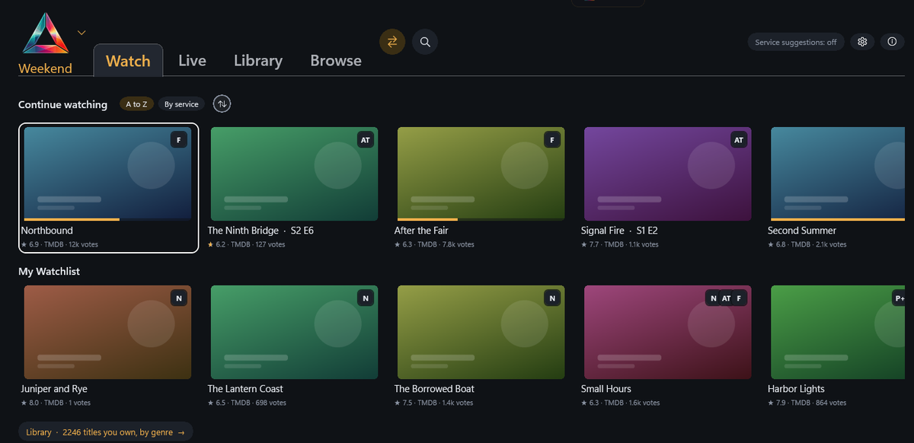
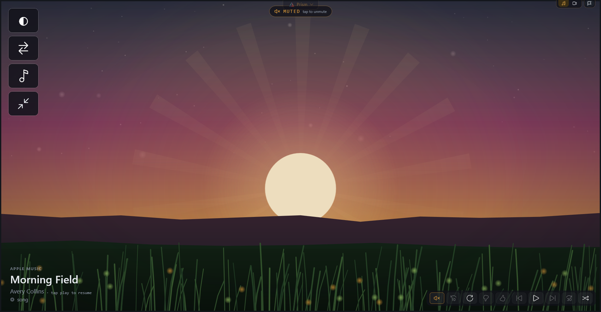

# PRISM by Entangled



PRISM is a free, open-source media player for Windows 11. It puts your streaming
services in one place, tells you when you already have a title on a service you pay
for, and covers ads with nature scenes and quiet instead of playing them. Your
sign-ins stay on your PC. No ads of its own, no subscriptions, no telemetry, no data
sales. It is in alpha.

**[Download for Windows](https://entangled.world/prism/download)** ·
[Releases](https://github.com/Boil5602/Prism-by-Entangled/releases) ·
[Website](https://entangled.world/prism) ·
[Take the tour](https://entangled.world/prism/tour) ·
[Changelog](CHANGELOG.md)

## Install

Needs Windows 11, 64-bit. Everything else comes inside the download.

1. Download the zip from the [download page](https://entangled.world/prism/download)
   or the [latest release](https://github.com/Boil5602/Prism-by-Entangled/releases).
2. Check the file against the SHA-256 shown on the download page and the release:
   ```powershell
   Get-FileHash Prism-<version>-<commit>.zip
   ```
3. Unzip anywhere and run `PrismHost.exe`.
4. Windows may say "Windows protected your PC" because this build is not code-signed
   yet. Press **More info**, then **Run anyway**.

Prism installs itself into `%LOCALAPPDATA%\Programs\Prism` (no administrator rights),
adds itself to the Start menu and runs from there from then on. The unzipped folder can
be deleted. Your data stays in `%LOCALAPPDATA%\Prism`. Updates arrive through
Prism menu > Updates, and only the files that changed are downloaded.

## What it does

- **Every service, one row.** Continue watching, your watchlist and what is on live,
  gathered from the services you sign in to. A title opens on the service that has it.
- **You already have it.** A heads-up when a title you are about to rent or buy is
  included in something you already pay for.
- **Ads covered.** Video, picture, text and music ads are covered with nature scenes
  and quiet. Prism observes only; it never signs in for you, breaks DRM or disguises
  itself. See [how Prism treats the services it shows](docs/third-party-services-policy.md).
- **Music with a view.** A music player with audio-reactive scenes and private
  listening to your phone.
- **Your phone is the remote.** Pair by QR code. It is a keyboard for the screen, a
  remote, and a pair of headphones.
- **Nothing leaves your PC.** No identifiers in any network call. Every connection
  Prism makes is listed in [docs/network.md](docs/network.md).



## For developers

Open-source dashboard frames: DIY hardware builds running web-tile dashboards. The
Windows app is the first. A browser extension (Veil, the ad-cover engine on its own) is
in development, and a Linux image for small boxes is planned.

### Repo shape (spec §23)

```
docs/                 the spec and project docs — docs/dashboard-schema.md is the source of truth
prototypes/           working reference code (editor with the reference solver, build wizard)
packages/
  core/               prism-core — the shared TypeScript brain; shells decide nothing
  editor/             prism-editor — the web designer (reference renderer)
  remote-ui/          (planned) phone remote PWA
  conformance/        prism-conformance — the kit that defines "is a Prism"
targets/
  win-host/           Prism for Windows — WinUI 3 + WebView2 tiles, prism-core as the brain
shells/
  android/            Kotlin shell — core in a hidden WebView, tiles as WebViews (parked)
  daemon/             prism-daemon — core in Node, tiles as Chromium windows via
                      CDP pipe (PrismOS on Linux; the Windows Build 5 recipe)
  ...                 (planned) PrismOS image build
```

### prism-core

Schema types (`frame.dashboard/v0.1`) and the deterministic hero-layout solver
(spec §8). Solver output is normative: `packages/core/tests/golden/solver-fixtures.json`
is the portable conformance artifact — every port on every platform must
reproduce those rects exactly for those inputs.

```
npm install
npm test          # golden fixtures + cross-check vs. the verbatim prototype solver
npm run build
```

Every behavior section of the spec lives in core (`packages/core/src`); shells
implement only the driver seam in `drivers.ts` and decide nothing:

| Spec | Module | Spec | Module |
|---|---|---|---|
| §3 audio focus | `audio-focus.ts` | §17 region focus | `focus.ts` |
| §4/§24 schedules, night, alarm | `schedule.ts`, `alarm.ts` | §18 tile lifecycle | `lifecycle.ts` |
| §5 adapters runtime | `adapters.ts` | §19 compatibility reports | `compat.ts` |
| §6 remote API + pairing | `remote.ts` | §21 VPN | `vpn.ts` |
| §7/§11 input mapping, remotes | `input.ts` | §25 living previews | `preview.ts` |
| §8/§9 solver, layout, carousel | `solver.ts`, `layout.ts`, `orchestrator.ts` | §26 intermission | `intermission.ts` |
| §12 launch tiles | `orchestrator.ts` | §27 gallery veil | `veil.ts` |
| §14 private listening | `listening.ts` | §28 updates | `updates.ts` |
| §15/§20 sharing + fit validation | `sharing.ts` | §16 no white frames | `refresh.ts` |

### prism-conformance

Drives any shell through the remote API (§6) alone and verifies the
observable contracts — auth, state shape, rects bit-identical to the
reference solver, hero re-solve, layout switching, carousel wrap:

```
npm run build
node packages/conformance/dist/cli.js http://<frame>:8471 <token> <bundle.json>
```

A shell that passes is a Prism (§23).

### Building, contributing, security

- **Build the Windows app:** [docs/building-windows.md](docs/building-windows.md)
- **Contribute:** [CONTRIBUTING.md](CONTRIBUTING.md) (GPLv3-or-later, signed-off commits, the gate `node scripts/verify.mjs`)
- **Report a security problem:** security@entangled.world, see [SECURITY.md](SECURITY.md)
- **How Prism treats the services it shows:** [docs/third-party-services-policy.md](docs/third-party-services-policy.md)

## License

Prism is free software: you can redistribute it and/or modify it under the terms of the
GNU General Public License as published by the Free Software Foundation, either version 3
of the License, or (at your option) any later version. See [LICENSE](LICENSE).

Copyright (C) 2026 Entangled Labs LLC. Prism by Entangled is a trademark of Entangled Labs LLC.
